# Morning report: "Today" planner

Morning 👋 Here's what got built overnight, what's tested, and the ~30 min of setup that's left for you.

Everything lives in the `planner/` folder on branch `claude/sleepy-gates-5jfm4c`.

---

## What you've got

| You asked for | Status |
|---|---|
| Open the app and see today's tasks, ordered by priority, with time estimates | ✅ Plus "planned vs free time left" and tasks carried over from earlier days |
| Tap a task and it animates open into steps and notes | ✅ Spring animation; tick steps, add steps (e.g. "Draft intro 20m"), notes autosave |
| Complete / discard / reschedule on everything | ✅ Buttons, or swipe right = done, swipe left = move. Every action has **Undo**. |
| Monthly calendar with the priority task on each day; tap a day to open it | ✅ Proper month grid, top task per day, "+N", workload bar, debrief markers, swipe between months |
| Minimal, smooth, barebones | ✅ One accent colour, system font, light and dark mode, no spinners on taps |
| Alarm-style reminders: before, at due time, then snooze until you act | ✅ 10 min before → due → every 10 min → every 5 min after 30 min. Stops when you complete, move or drop the task. All configurable. |
| Debriefs that follow the calendar, a few times a week | ✅ Sunday evening "week ahead", plus the night before heavy days or top-priority deadlines. Max 3/week, never back-to-back. Shown on the calendar in advance; you can move or cancel any of them. |
| Check-ins for any task, more often for important ones | ✅ Scored by priority, how close or overdue the task is and how long you've been away from the app. Max 4/day, 75 min apart (both adjustable). |
| Late at night: "yo, u up for a quick check-up?"; no answer or "no" = nothing till morning | ✅ After 21:30 it asks first. "Not tonight", or 10 min with no answer, means silence till 08:00. There's also a 🌙 "I'm going to sleep" button. |
| Talk to it and it edits the plan for you | ✅ Full-screen voice "call". It listens, replies out loud and changes tasks live (move, add, complete, add steps and notes). Changes show instantly on every device and are logged under Recent calls. |
| Phone and laptop | ✅ Same app on both, synced live |
| Small login | ✅ Username and password (securely hashed), stays logged in |
| Free / open source | ✅ Ollama (AI), whisper.cpp (speech-to-text), Kokoro (natural voice), all running on your own free server |

### Screenshots (taken automatically from the real app)

| Today | Task opened | + menu | Month |
|---|---|---|---|
| 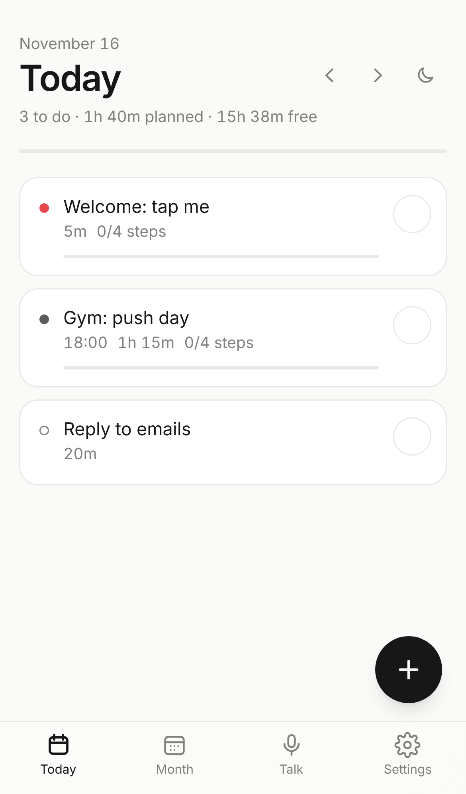 | 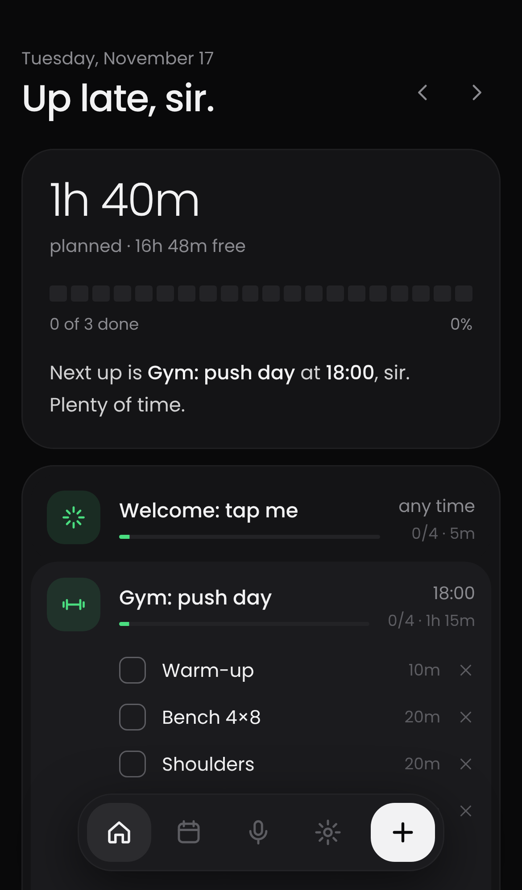 | 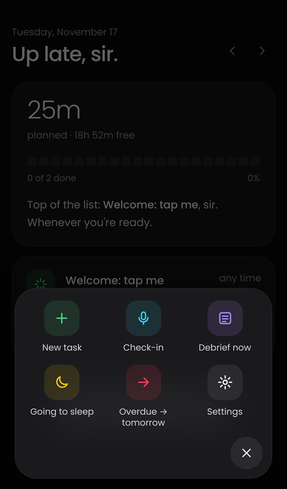 | 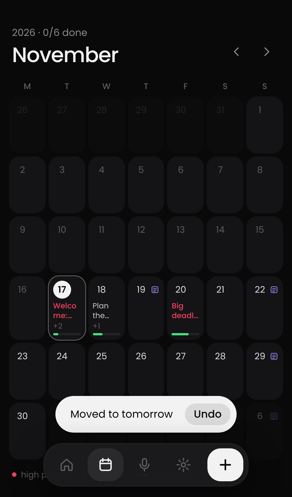 |

| Settings | Talk | Voice check-in | Laptop |
|---|---|---|---|
| 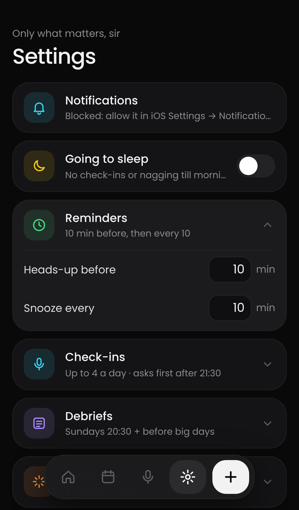 | 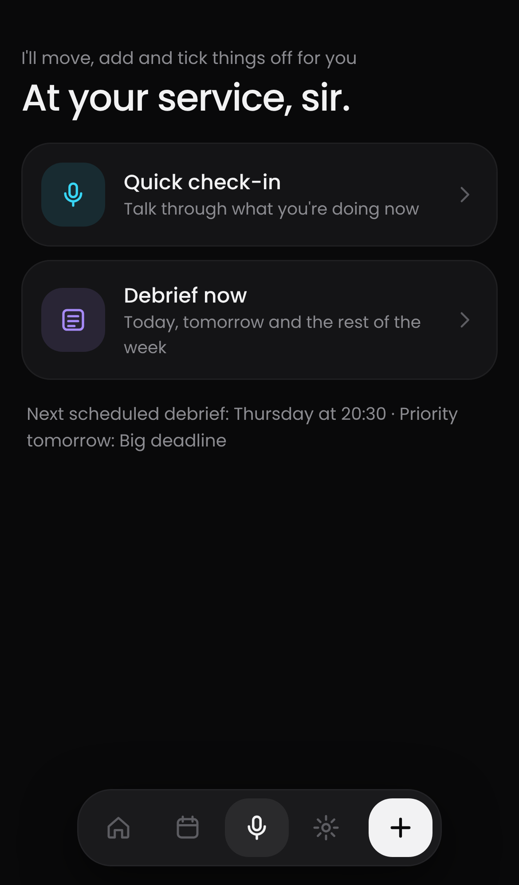 | 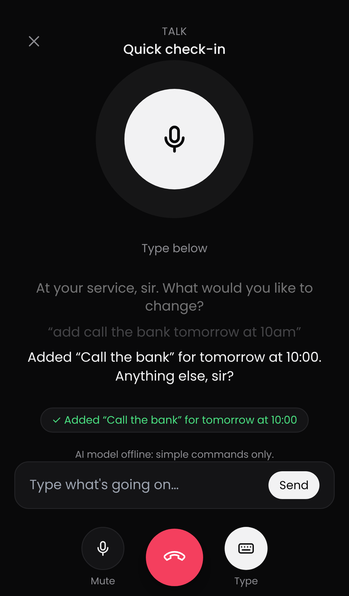 | 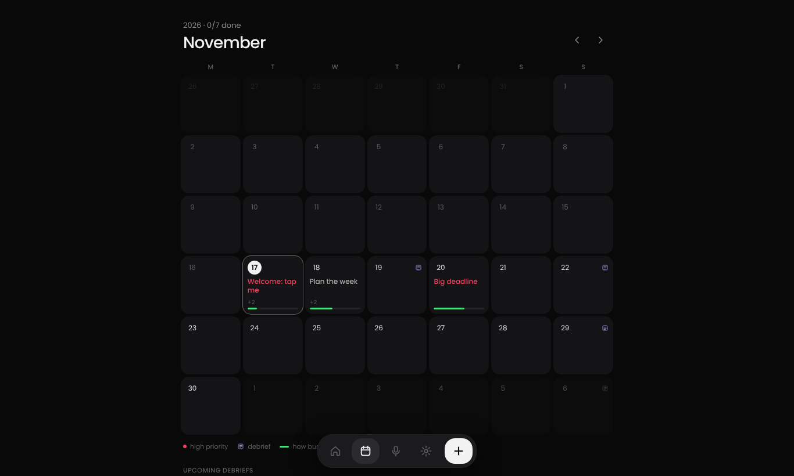 |

---|---|---|---|
|  |  | 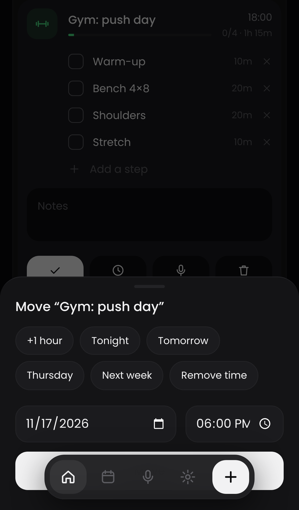 | 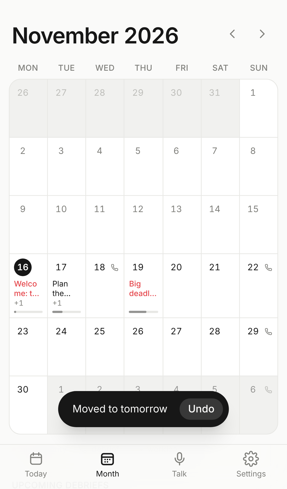 |

| Voice check-in | Settings | Dark mode | Laptop |
|---|---|---|---|
| 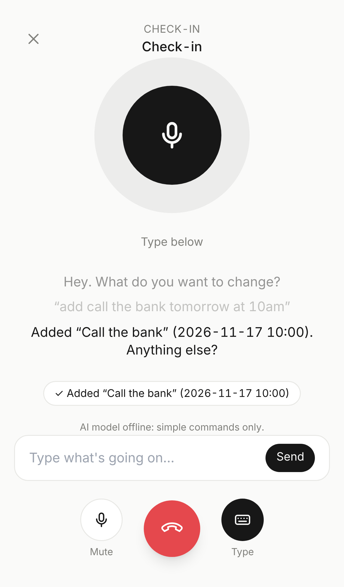 | 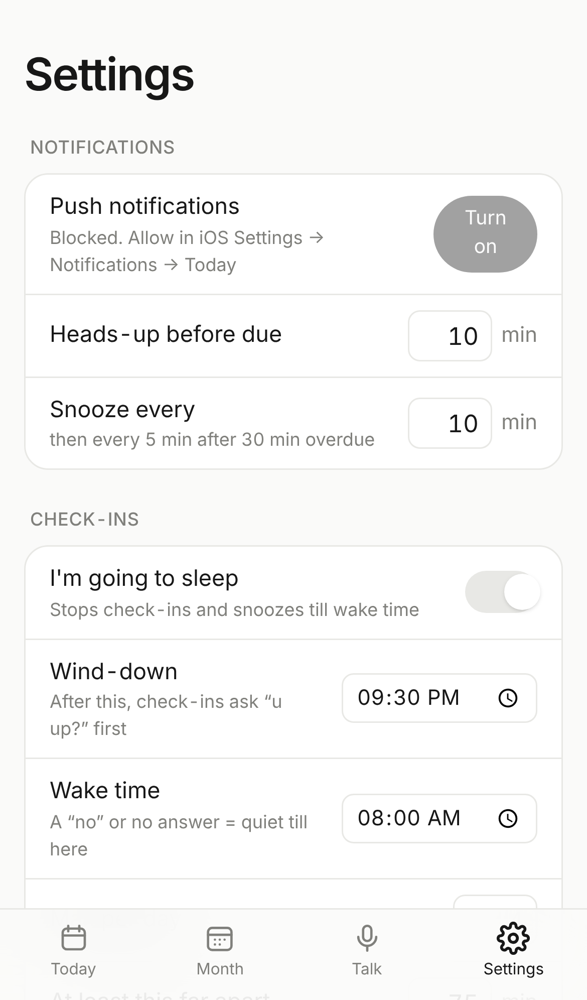 | 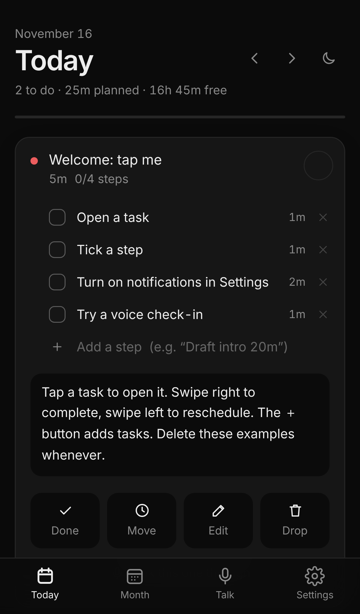 |  |

---

## What's tested, and what isn't yet

**Tested here ✅**
- 27 automated tests covering the alarm/snooze timing, debrief planner, check-in scoring, the "u up?" consent and quiet-till-morning flow, every AI tool (add/move/complete/etc.), login, and the API.
- The real app in a browser at iPhone and laptop sizes, light and dark, with zero errors.
- Two devices at once: a change on the laptop appears on the phone in about 30 ms. Edits made offline sync when you reconnect. The app installs its offline support.
- The app's Docker image builds and runs.

**Not tested yet ⚠️ (this sandbox can't download them; they get built on your Oracle server)**
- **The AI model's replies.** The tool-calling loop is tested with a stand-in model, but the real one (Qwen3 via Ollama) first runs on your server. Until it's running, voice still works in "simple mode": "done with X", "move X to tomorrow", "add X tomorrow at 3pm", "going to sleep".
- **The whisper.cpp and Kokoro containers** (speech in and out). If either fails to build, the app falls back to your iPhone's built-in speech recognition and voice.
- **Real iPhone notifications.** These need the HTTPS address from step 3 and a real phone.

**Things to know**
- **Your phone won't ring.** As agreed, check-ins arrive as notifications that open the voice screen.
- **iPhone notifications have no action buttons** (an Apple limit for web apps). You tap and choose in the app.
- **Voice speed on the free server.** It runs on CPU, so expect the first reply of a call to take ~10–30 s and later ones ~5–10 s. If that's too slow, set `OLLAMA_MODEL=qwen3:1.7b` in `.env` (faster, a bit less clever).
- **Focus/Do Not Disturb** will hold notifications unless you allow the app in that Focus.

---

## Your setup (≈30 min, £0)

### 1. Create the free Oracle server (~10 min)
1. Sign up at **cloud.oracle.com** → "Start for free". They ask for a card to verify you're a real person; Always Free resources aren't charged. Pick your **home region** carefully (e.g. UK South, London), because it can't be changed later.
2. In the console: **Compute → Instances → Create instance**
   - **Image:** Canonical Ubuntu 24.04 (the *aarch64* one)
   - **Shape:** Ampere → **VM.Standard.A1.Flex**, **4 OCPU, 24 GB RAM** (the Always Free maximum)
   - **Networking:** create a new VCN + public subnet, tick **Assign a public IPv4 address**
   - **SSH keys:** "Generate a key pair" → **download the private key** (keep it safe)
   - Create. If it says **"Out of capacity"**, try another availability domain or retry later. This is common and usually clears.
3. Note the instance's **public IP**.

### 2. Open the web ports in Oracle (~2 min)
Instance page → click the **subnet** → **Security List** → **Add Ingress Rules**:
- Source `0.0.0.0/0`, TCP, destination port **80**
- Source `0.0.0.0/0`, TCP, destination port **443**

### 3. Get a free web address (~2 min)
1. Go to **duckdns.org** and sign in (GitHub/Google).
2. Create a subdomain, e.g. `myplanner` → `myplanner.duckdns.org`.
3. Paste your Oracle **public IP** into it → *update ip*.

### 4. Install it (~2 min of typing, then 10–20 min of waiting)
On your Windows laptop, open **PowerShell**:
```powershell
ssh -i C:\Users\YOU\Downloads\ssh-key-XXXX.key ubuntu@YOUR_PUBLIC_IP
```
Then on the server:
```bash
git clone -b claude/sleepy-gates-5jfm4c https://github.com/M1107w/Sitemap-hosting.git
cd Sitemap-hosting/planner
bash deploy/oracle-setup.sh
```
*(If the repo is private, git asks for a username and password. Use your GitHub username and a [personal access token](https://github.com/settings/tokens) as the password.)*

The script installs Docker, opens the firewall, sets up nightly backups, asks for your DuckDNS name, and starts everything. The first run downloads the AI model (~2.5 GB) and builds the speech services, so give it 10–20 min. Check progress with:
```bash
sudo docker compose logs -f ollama-pull     # AI model download
curl -s https://myplanner.duckdns.org/api/health
```
Health should eventually say `"ollama":true,"whisper":true,"tts":true`.

### 5. iPhone (~2 min)
1. Open **Safari** → `https://myplanner.duckdns.org`
2. **Share → Add to Home Screen** → open **Today** from your home screen *(push only works from the home-screen app)*
3. Create your login (tick "Add a few example tasks" if you want a demo)
4. **Settings → Push notifications → Turn on → Allow**, then **Send a test**
5. Optional: iOS Settings → Focus → allow **Today** so late check-ins get through

### 6. Windows laptop (~1 min)
1. Open **Edge** or **Chrome** → `https://myplanner.duckdns.org`
2. Click the **install icon** in the address bar ("App available → Install"). It now opens like a normal desktop app from the Start menu.
3. Log in with the same account. It syncs live with your phone, and you can turn on notifications there too (they show in the Windows notification centre).

---

## Day-to-day
- **Update after I change code:** `cd Sitemap-hosting/planner && git pull && sudo docker compose up -d --build`
- **Backups:** nightly at 04:00 into `planner/data/backups/` (last 14 kept)
- **Change the AI model / voice:** edit `.env`, then `sudo docker compose up -d --build`
- **Run it on the laptop for tinkering** (optional): install Node 22, then in `planner/` run `npm install` and `npm run dev`, and open http://localhost:5173. For AI locally, install Ollama for Windows and `ollama pull qwen3:4b`.

## What I'd do next (your call)
1. Once it's running on Oracle, try a few real voice check-ins and tell me where the AI gets it wrong. I'll tune the prompt and tools.
2. Recurring tasks (daily gym, weekly review): not built yet, and the next obvious feature.
3. A real ringing call would need a paid number (Twilio) or a paid Apple developer account. Skipped, per the $0 plan.
